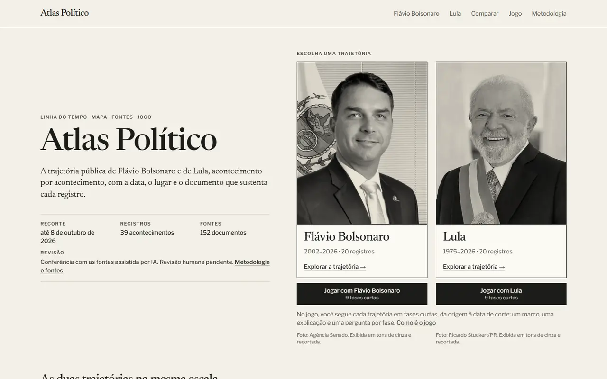

**English** | [Português](README.pt-BR.md)

# Atlas Político

Working title. An atlas (in Brazilian Portuguese) for following the public careers of Lula and Flávio Bolsonaro through a timeline, a map, events backed by the sources that support them, and a game that walks through both careers in short stages, from their origins to the cut-off date. A MilWeb portfolio project.

Since October 17, 2026 (content edition 0.4.0) the game also has an investigation mission, "O documento diz o quê?" (what does the document say?): the Escrivão hands out index cards, the player opens real records from the drawer, builds a dossier, matches each card to the record that supports it and points to the field that supports the highlighted passage ([docs/MISSAO-INVESTIGACAO.md](docs/MISSAO-INVESTIGACAO.md), in Portuguese). The Cidade do Voto prototype had its scene lifecycle fixed and gained two more choices ([docs/MUNDO.md](docs/MUNDO.md)). A newer direction, the Praça do Mural (`/praca/`), is an investigation adventure in a compact Brazilian town square: residents pin questions on a board, and the player, the new reporter of the community radio, finds in the archive the record that answers each one ([docs/PRACA.md](docs/PRACA.md), in Portuguese). On October 18, 2026 the atlas was redesigned around it (D-155): a dark stage around the paper sheet, a four-entry menu (Explore, Compare, Play, Methodology), a home page with **Começar investigação** (start the investigation), a `/jogo/` hub with three paths, a comparison in three parts (career, decisions, proposals) and, in the square, a tutorial, ordering and nature tasks, a current step, discoveries and seals.

> **Type:** MilWeb portfolio project, in development. It is not an official site of either person portrayed, of any party or of any public body. There is no definitive public address yet: the provisional Vercel address and the publication status are documented in [docs/DEPLOY.md](docs/DEPLOY.md).

> **Project in development. Do not use it as a source.** The content is about two public figures and was checked only with AI assistance: no person has redone the review of the whole set, and validation with readers is pending. Since October 11, 2026 the site answers at a provisional, non-indexed Vercel address: every page carries `noindex`, and what is there may differ from this repository; the verified status is in [docs/DEPLOY.md](docs/DEPLOY.md). Every record lists the sources that support it; when in doubt, the cited document prevails.



**Current stage:** phases 1 to 8 of 10 are done (foundation, first content set, data layer, experience and visual direction, timeline app, synchronized map, comparison, pages and sources, visual finish and performance). Phase 9 has its editorial and technical work done; validation with people is pending. The atlas ships content edition 0.3.0, with a cut-off date of October 8, 2026: 39 sourced events for the two profiles, a sample of documented decisions (votes, Executive acts and legislative work), the platforms each candidacy registered with the electoral court (TSE), and the game trail content. A local pipeline validates the content, selects what has been reviewed and generates the data, indexes and GeoJSON the pages read.

What each phase delivered, in short:

- **Phase 4:** visual direction and the four screens (home, exploration, event and comparison) on desktop, tablet and phone.
- **Phase 5:** time navigation: pick a person, query a year or a range, filter categories, open an event and read the details, with the whole query in the URL.
- **Phase 6:** the map follows that selection: one marker per documented place, two-way selection, a list for events that share a place, and reading preserved when the map fails.
- **Phase 7:** comparison of both people over the same range, with the query in the URL; complete profile and event pages with sources, credits, review and edition; **Copiar link** (copy link) and return to the previous selection; public methodology.
- **Phase 8:** finish: portraits in local versions sized for each screen, map loaded only when used, short transitions, revised hierarchy, and performance measured before and after ([docs/PERFORMANCE.md](docs/PERFORMANCE.md)).
- **Phase 9:** reopened all 60 sources, re-read each record against the documents, fixed what was found and tested the journeys on the static export ([docs/EDITORIAL-REVIEW.md](docs/EDITORIAL-REVIEW.md), [docs/QA.md](docs/QA.md)); the script for validation with three people is ready but has not been applied ([docs/USER-VALIDATION.md](docs/USER-VALIDATION.md)).
- **Game:** rebuilt on October 11, 2026 as a simple trail. The visitor picks one of the two people and follows their life in nine short stages, from origin to the 2026 election. Each stage has a milestone, a 60 to 100 word explanation with terms explained and sources, and an activity (a question or an ordering task). Mistakes cost nothing, reading the explanation instead of answering also completes a stage, and no stage blocks the next. Economy and Public Security are optional deep dives. The same content can be read without the scenery, and court-case episodes include a case card with the nature of the decision and related dated decisions ([docs/GAMEPLAY.md](docs/GAMEPLAY.md), [docs/GAME-TRAIL.md](docs/GAME-TRAIL.md)).

All content checking was AI-assisted and human review is pending ([docs/HUMAN-REVIEW.md](docs/HUMAN-REVIEW.md)); for that reason the publication gate still refuses ([docs/DEPLOY.md](docs/DEPLOY.md)). A push to `main` publishes to the provisional address: read that document before pushing a commit. What is ready, what is still a demo and what is missing is in [docs/STATUS.md](docs/STATUS.md).

The interface and the content are in Brazilian Portuguese; most project documentation in `docs/` is in Portuguese too.

## Requirements

| Item | Version |
|---|---|
| Node.js | 22.18 or newer, or 24 (developed and verified on 24.15.0) |
| npm | 11 (the project lock is `package-lock.json`; do not mix with pnpm or yarn) |
| Browser | WebGL 2 to see the map. Without it the atlas shows the places as a list and everything else works the same |
| Playwright Chromium | Only for the browser test suites. On a new machine: `npx playwright install chromium` |

No external service, account or environment variable. Everything runs from the project files. One configuration is pending and blocks nothing: the public correction channel in `src/lib/site.ts` (docs/PAGES.md, section "Configuração pendente").

Node 22.18 is the minimum because the data commands run the project's TypeScript directly in Node, without compiling.

### Installed versions

| Package | Version | Used for |
|---|---|---|
| next | 16.4.0 | App, routes and static export (Turbopack) |
| react, react-dom | 19.3.0 | Interface |
| typescript | 5.9.3 | `strict` mode plus `noUncheckedIndexedAccess` and `erasableSyntaxOnly` |
| tailwindcss, @tailwindcss/turbopack | 4.3.3 | Styling, on top of CSS variables |
| maplibre-gl | 6.13.0 | Map |
| zod | 4.6.5 | Content schemas |
| server-only | 0.0.1 | Keeps content reading out of the browser |
| vitest | 5.0.3 | Tests for data rules, pipeline and state |
| @playwright/test | 1.63.0 | Browser tests and preview captures |
| eslint, eslint-config-next | 9.39.5, 16.4.0 | Lint and layer boundaries |
| sharp | 0.35.5 | Development only: prepares portrait versions (`npm run images`). Not shipped to the site |

The typefaces (`src/app/fonts/`) and the map outlines (`src/features/map/base/`) are project files, with each license described in its own folder. The map uses no tiles, API key or third-party service.

## Installation

```bash
npm install   # or `npm ci` for a clean install from the lockfile
```

## Running locally

```bash
npm run dev
```

Generates the data and opens http://localhost:3000. If the content has an error, the command stops before starting the server and shows what to fix. With the server running, editing a file in `content/` and reloading the page is enough: the data is regenerated, and errors are shown on the page.

Screens (docs/UX.md):

| Screen | URL |
|---|---|
| Home | http://localhost:3000/ |
| Explore: choosing a career | http://localhost:3000/explorar/ |
| Exploration | http://localhost:3000/politicos/lula/ and http://localhost:3000/politicos/flavio-bolsonaro/ |
| Event | http://localhost:3000/acontecimentos/lula-2023-intervencao-federal-no-distrito-federal/ |
| Comparison | http://localhost:3000/comparar/ (`#decisoes` or `#propostas` opens that part) |
| Methodology | http://localhost:3000/metodologia/ |
| Play: the hub with three paths | http://localhost:3000/jogo/ |
| Praça do Mural (town square) | http://localhost:3000/praca/ |
| Cidade do Voto (city prototype) | http://localhost:3000/mundo/ |
| Game: both careers | http://localhost:3000/jogo/trajetorias/ |
| Game: one character's career | http://localhost:3000/jogo/lula/ and http://localhost:3000/jogo/flavio-bolsonaro/ (`?fase=3` opens stage 3; `&leitura=1` removes the scenery) |
| Game: deep dives with the documented decisions on a topic | http://localhost:3000/jogo/lula/economia/, http://localhost:3000/jogo/lula/seguranca-publica/ and the same for `flavio-bolsonaro` |
| State guide, development only | http://localhost:3000/dev/previa/ |
| Game art gallery, development only | http://localhost:3000/dev/jogo-arte/ |

In exploration, the period, categories and open event live in the URL, so the view can be reloaded, shared and navigated with back and forward (docs/TIMELINE.md). Parameters: `de` and `ate` (four-digit year), `categorias` (comma-separated identifiers) and `acontecimento` (slug). An invalid parameter is dropped and the URL is corrected in place. Examples:

| Query | URL |
|---|---|
| One year | http://localhost:3000/politicos/lula/?de=2018&ate=2018 |
| A range and two categories | http://localhost:3000/politicos/lula/?de=2016&ate=2022&categorias=eleicoes,marcos-historicos |
| An event open inside a range | http://localhost:3000/politicos/lula/?de=2016&ate=2019&acontecimento=lula-2018-prisao-em-curitiba |
| A year with a party change | http://localhost:3000/politicos/flavio-bolsonaro/?de=2021&ate=2021 |
| A period with no records | http://localhost:3000/politicos/lula/?de=1996&ate=2001 |

The map follows the same query (docs/MAP.md):

| Map state | URL |
|---|---|
| An event with two places, both highlighted | http://localhost:3000/politicos/lula/?acontecimento=lula-2023-intervencao-federal-no-distrito-federal |
| A nationwide event, with no point | http://localhost:3000/politicos/lula/?acontecimento=lula-2002-eleito-presidente |
| A selection with no points | http://localhost:3000/politicos/flavio-bolsonaro/?de=2021&ate=2021 |

On narrow screens the map is in the **Mapa** view. To see the list of places that takes over when the map fails, open http://localhost:3000/dev/prova/ and turn on **Simular navegador sem WebGL**.

Comparison keeps the period and categories in the URL, and pages open by direct link (docs/COMPARISON.md and docs/PAGES.md):

| What opens | URL |
|---|---|
| Both careers over a range, with one category | http://localhost:3000/comparar/?de=2016&ate=2022&categorias=eleicoes |
| A period where one career is outside coverage | http://localhost:3000/comparar/?de=1996&ate=2001 |
| The profile, with offices, parties, sources and edition | http://localhost:3000/politicos/flavio-bolsonaro/ (on narrow screens, in the **Perfil** view) |
| An event page by direct link | http://localhost:3000/acontecimentos/lula-2018-prisao-em-curitiba/ |
| The same page coming from a query: going back restores the selection | http://localhost:3000/acontecimentos/lula-2018-prisao-em-curitiba/?de=2016&ate=2019&categorias=marcos-historicos |
| The correction template, prefilled with the record | http://localhost:3000/metodologia/?acontecimento=lula-2018-prisao-em-curitiba#correcao |

In the game (docs/GAMEPLAY.md): tap the highlighted folder, or the **Abrir o marco** button, read the explanation, answer the activity or ask for its explanation, and use **Continuar**. Nobody steers the character: the folders are page buttons reachable by keyboard. **Fases** opens any stage, and **Ler sem o cenário** shows the same content without the scene. Progress is stored in the browser, per character, and is not put in the URL.

**Copiar link** copies the current atlas URL. On a page served over plain `http` from another machine, the browser does not allow copying, so the link appears in a field.

Technical proof screens that only exist under `npm run dev` and are not part of the production build:

| URL | Data | Purpose |
|---|---|---|
| http://localhost:3000/dev/dados/ | The edition's own, read from `generated/` | See the whole path with real content: generator, reader, list, map and panel |
| http://localhost:3000/dev/prova/ | Synthetic, from the test fixtures | Exercise edge cases: partial dates, two places, no place, map failure |

On both you can select an event in the list and watch the map and panel follow; click a map marker and watch the list and panel follow (a numbered marker first opens the list of events at that place); switch person and see list, map and panel show the same selection; and turn on "Simular navegador sem WebGL" to see the places list replace the map.

## Data

The content is JSON in `content/`, maintained directly in the repository and not generated by any command. Pages do not read that folder: they read `generated/`, which a command produces after validating everything. The full process is in [docs/DATA-PIPELINE.md](docs/DATA-PIPELINE.md).

| Command | What it does |
|---|---|
| `npm run data:validate` | Checks the content and shows errors, pending items and warnings. Writes nothing |
| `npm run data:build` | Validates and generates `generated/`: published set, indexes and GeoJSON |
| `npm run data:report` | Coverage by person, period and category, map points and pending items, in Markdown |
| `npm run data:import -- <file.json>` | Imports a JSON package into `content/drafts/` as a draft. With `--dry-run`, only shows the result |
| `npm run data:query -- [filters]` | Queries the generated data: `--pessoa`, `--de`, `--ate`, `--categorias`, `--lugar`, `--acontecimento` |

Examples:

```bash
npm run data:query -- --pessoa lula --de 2016 --ate 2019
npm run data:import -- pesquisa/pacote.json --source "Planilha de outubro" --dry-run
npm run data:report -- --out docs/DATA-REPORT.md
```

`npm run dev` and `npm run build` already generate the data. Invalid content stops both.

## Static build

```bash
npm run build     # generates the data, checks the portraits, builds out/ and adjusts it
npm run preview   # serves out/ at http://localhost:4311
```

`out/` is a static site: any host can serve it, with no Node.js in production. `next start` does not apply to this project.

`npm run build` does four things, in order: generates the data (`data:build`), checks that the portrait versions are up to date (`images:check`), runs `next build` and adjusts the output (`scripts/finalize-export.mjs`). The adjustment restores navigation files to the name the browser requests, removes unused MapLibre files and completes font preloading on event pages. The reason for each step is in [docs/PERFORMANCE.md](docs/PERFORMANCE.md).

`npm run preview` behaves like a regular host: gzip compression, `ETag` and long caching for `/_next/static/` files.

### Portraits

Pages never request a portrait's original file: they request smaller versions already cropped for each frame. When replacing a portrait in `public/media/retratos/`, or the framing in `scripts/images.config.json`:

```bash
npm run images         # generates public/media/derivados/ and the manifest
npm run images:check   # only checks; this is what `dev` and `build` run
```

Check the result before continuing: framing follows the same rule for both profiles (eye line at the same height, face at the same size).

## Verification

| Command | What it checks |
|---|---|
| `npm run lint` | ESLint, including the boundaries between layers |
| `npm run typecheck` | Generates route types and runs `tsc` |
| `npm run test` | Vitest suites: dates, schemas, integrity, pipeline, queries, generation, import, commands, state, URL and history, comparison, cross-screen links and return, portrait versions, map points, places and camera, timeline, chronological list, coverage, visual base (including color contrast), decision card, comparison summary, platforms, and the game (trail rules, progress and its migration, storage, URL, scenes, path and camera, the "Escrivão" guide, sensitive context, case card and the stages against the content) |
| `npm run build` | Generates the data and the site. Fails on invalid content |
| `npm run verify:export` | Checks `out/`: expected pages, one page per published event and none per draft, no development routes, no synthetic data, portrait versions published, navigation files in place, no unused MapLibre files and font preload on every page |
| `npm run check` | The five above, in sequence |
| `npm run test:e2e` | Proof screens, the four screens, time navigation with the URL, synchronized map, comparison, profile, event and methodology pages, the finish (four widths, transitions, link with query and the main journey) and the game, in a real Chromium (Playwright) on desktop, tablet and phone. Starts its own server on port 4310 |
| `npm run test:export` | On the static output, after `npm run build`: what each page requests and when, map loaded only when used, portrait versions, prefetched navigation, and the game stage in a separate bundle requested only on the game page with scenery. Starts its own server on port 4311 |
| `npm run test:journeys` | The `test:e2e` journeys with real data, run on the static output after `npm run build`. This is what reveals defects the dev server hides ([docs/QA.md](docs/QA.md)) |
| `npm run audit:a11y` | Accessibility pass on the static output: contrast of rendered text, horizontal scroll, targets and focus order, on twenty-eight screens and four widths. Writes captures and a report to `test-results/a11y/` |
| `npm run capturas:verificar` | Checks the raw archive captures in `research/capturas/`: SHA-256 digest, size and response against the original body |
| `npm run verify:release` | The publication gate: refuses while any record lacks human review, or while the domain and correction channel are undefined; warns about disabled indexing and the missing license. Not part of `check`, so development is not blocked by it ([docs/DEPLOY.md](docs/DEPLOY.md)) |
| `npm run release:check` | The publication bar in one command: `check`, `capturas:verificar` and `verify:release`, in this order |
| `npm run measure -- --rotulo <name>` | Measures loading, visual stability, weight and interaction response on the static output and writes `docs/desempenho/<name>.json`. With `--contra <name>=<folder>`, compares two builds |
| `npm run measure:game -- --rotulo <name>` | Lab measurements of the game pages on the static output; writes `docs/desempenho/jogo-<name>.json` |
| `npm run game:coverage` | Rewrites `docs/GAME-COVERAGE.md`, the game coverage matrix, from the data; with `-- --check`, only checks |
| `npm run review:human` | Rewrites `docs/HUMAN-REVIEW.md`, the list of what needs human review, from the data; with `-- --check`, only checks |
| `npm run importar:decisoes -- <senado\|camara> …` | Captures votes from the official archives (Senate, Chamber), normalizes them and imports everything as drafts in `content/drafts/`, with raw captures in `research/`. The only command that uses the network; `--dry-run` writes nothing ([docs/DATA-PIPELINE.md](docs/DATA-PIPELINE.md)) |
| `npm run capture:game`, `capture:finish`, `capture:pages`, `capture:map`, `capture:timeline`, `capture:preview` | Redo the screenshots in `docs/capturas/` (game trail, phases 8, 7, 6, 5 and 4). They only record screens |
| `node scripts/capture-art.mjs --saida <folder>` | With `npm run dev` running, captures the game art gallery as PNG |
| `node scripts/share-image.mjs` | Rewrites `public/share/atlas.png`, the share preview image |

Before any delivery: `npm run check`, `npm run test:journeys`, `npm run test:export` and `npm run test:e2e`, one at a time. GitHub Actions repeats this on every push to `main` and every pull request (`.github/workflows/verificacao.yml`: one job with `check`, the export suites, the accessibility pass and the coverage/review checks; another with the journeys on the dev server), keeping test results when something fails. Nothing there publishes.

## Structure

```
content/
  published/     the edition: records in the `revisado` state (AI-assisted checking)
  drafts/        research in progress and imports
generated/       data generated by `npm run data:build` (not in Git)
docs/            architecture, data, experience, performance, decisions, status and captures
  desempenho/    raw measurement results (JSON)
  screenshots/   the image used in this README
public/
  media/         portraits and images, as registered
    derivados/   portrait versions the pages request (generated by `npm run images`)
research/        raw captures from official archives and decision import packages (never read by the pipeline)
scripts/         data commands, portrait preparation, output adjustment, checks, preview and measurement
src/
  app/           routes and pages; typefaces in app/fonts/
  components/    visual base: portrait, date, category, sources, profile, copy link, person switch, timeline pieces
  features/
    events/      chronological list, gaps and event reading
    map/         map, markers, place picker, camera and base outlines
    timeline/    timeline, period, categories, offices and parties for the period
    comparison/  careers on the same scale
    game/        the game: shell, stage, drawing (draw/), engine (engine/) and interface (ui/)
  lib/
    domain/      data rules and contracts, no I/O
    data/        public data format, indexes, points and queries
    game/        game rules without UI: trail, progress, URL, rooms, presentation, scenery, world, Escrivão and case card
    praca/       Praça do Mural rules without UI: sessions, places, residents, board questions, drawers, the note, the council minutes and saved progress
    media/       frames, widths and names of the portrait versions
    publication/ validation, eligibility, report and import, no I/O
    content/     reading content/ and reading/writing generated/
    state/       shared state, selectors, URL, history and cross-screen links
    site.ts      configuration that depends on the owner's decision (correction channel, domain, indexing)
tests/
  fixtures/sintetico/   test data, all marked as synthetic
  e2e/                  browser tests on the dev server
  export/               tests and captures on the static output
```

## Documentation

Project documentation is in Portuguese, in [docs/](docs/). Main entry points:

- [docs/ARCHITECTURE.md](docs/ARCHITECTURE.md): layers, data flow, routes and state.
- [docs/DATA_MODEL.md](docs/DATA_MODEL.md) and [docs/DATA-PIPELINE.md](docs/DATA-PIPELINE.md): entities, rules, validation, generated data, queries and import.
- [docs/DATA-REPORT.md](docs/DATA-REPORT.md): coverage report for the current edition.
- [docs/UX.md](docs/UX.md), [docs/DESIGN-SYSTEM.md](docs/DESIGN-SYSTEM.md), [docs/INTERACTIONS.md](docs/INTERACTIONS.md): visual direction, tokens, components and interactions.
- [docs/TIMELINE.md](docs/TIMELINE.md), [docs/MAP.md](docs/MAP.md), [docs/COMPARISON.md](docs/COMPARISON.md), [docs/PAGES.md](docs/PAGES.md): each part of the atlas.
- [docs/GAMEPLAY.md](docs/GAMEPLAY.md), [docs/GAME-TRAIL.md](docs/GAME-TRAIL.md), [docs/GAME-COVERAGE.md](docs/GAME-COVERAGE.md): the current game. [docs/VOTOS-E-ESCRIVAO.md](docs/VOTOS-E-ESCRIVAO.md) and [docs/GAME-RELEASE.md](docs/GAME-RELEASE.md) are historical.
- [docs/EDITORIAL.md](docs/EDITORIAL.md), [docs/SOURCES.md](docs/SOURCES.md), [docs/CONTENT-REVIEW.md](docs/CONTENT-REVIEW.md), [docs/EDITORIAL-REVIEW.md](docs/EDITORIAL-REVIEW.md), [docs/HUMAN-REVIEW.md](docs/HUMAN-REVIEW.md): editorial criteria, sources, reviews and the pending human review.
- [docs/QA.md](docs/QA.md), [docs/PERFORMANCE.md](docs/PERFORMANCE.md), [docs/USER-VALIDATION.md](docs/USER-VALIDATION.md): technical checks, measurements and the (not yet applied) user validation script.
- [docs/DEPLOY.md](docs/DEPLOY.md): publication status, procedure and what depends on a decision.
- [docs/DECISIONS.md](docs/DECISIONS.md) and [docs/STATUS.md](docs/STATUS.md): decisions and status of each phase.
- [docs/capturas/](docs/capturas/README.md): real screenshots, by phase.
- [content/README.md](content/README.md): content file contract and how to edit.

## Limitations

- Content was checked with AI assistance only; human review and reader validation are pending, and the publication gate (`npm run verify:release`) refuses on purpose.
- No public domain, correction channel or indexing has been decided yet (`src/lib/site.ts`).
- The interface and the documentation in `docs/` are in Portuguese only.

## Media credits

Portraits (`public/media/retratos/`) have their credit, origin and terms of use recorded in `content/published/imagens.json` and shown on the pages. Typefaces (`src/app/fonts/`) and map outlines (`src/features/map/base/`) carry their own licenses in their folders. The screenshot above comes from `docs/capturas/jogo-trilha/`.

## Security

See [SECURITY.md](SECURITY.md) to report vulnerabilities privately. To contribute, see [CONTRIBUTING.md](CONTRIBUTING.md).

## License

No license has been chosen yet; all rights reserved by the author. Portraits, typefaces and map outlines follow their own licenses cited above.
